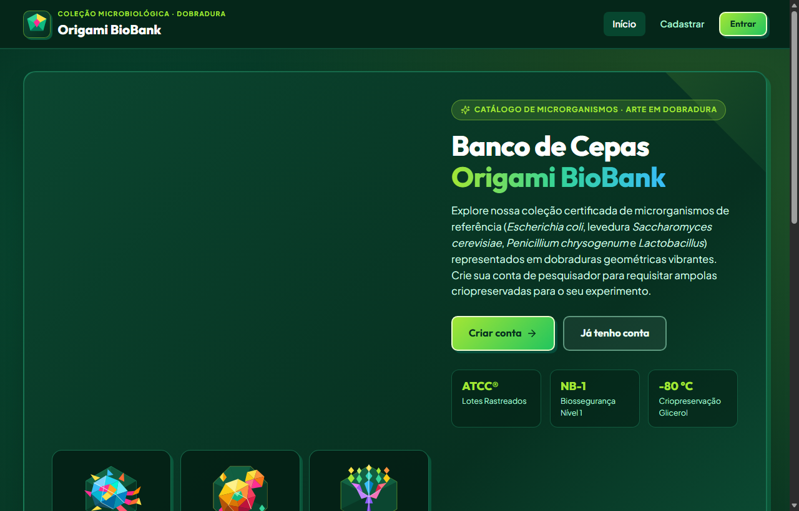

# Origami BioBank | Catálogo & Requisição de Cepas Microbiológicas

<div align="center">



-10b981?style=for-the-badge&logo=checkmarx&logoColor=white)


> **Um biorrepositório web interativo e catálogo científico de microrganismos (*Escherichia coli*, levedura *Saccharomyces cerevisiae*, *Penicillium chrysogenum* e *Lactobacillus acidophilus*) com identidade visual artística em dobradura (Paper Craft / Origami Design), integrado em tempo real ao Supabase PostgreSQL.**

</div>

---

## Sobre o Projeto

**Origami BioBank** é uma plataforma laboratorial desenvolvida para gerenciamento, consulta e requisição de cepas microbiológicas criopreservadas para experimentos acadêmicos e científicos. Construído com **React** e **Supabase**, o sistema une rigor de validação e controle de estoque em banco de dados relacional a uma direção de arte original em **Paper Design (Dobradura)** sobre paleta esmeralda, onde cada microrganismo do acervo é representado por ilustrações vetoriais poliédricas com vincos de papel, facetas de luz/sombra e cores vibrantes.

O projeto contempla todas as **7 telas obrigatórias** da especificação de Engenharia e Teste de Software, acompanhadas de **24 Requisitos Funcionais (RF01 a RF24)** e uma bateria completa de **38 Casos de Teste Manuais e de Banco de Dados (`CT-MAN-1` a `CT-MAN-38`)**.

---

## Funcionalidades Principais

### 1. Identidade Visual Paper Craft & Ilustrações em Dobradura (SVG)
* **Arte Poliédrica Exclusiva por Linhagem (`MicrobeOrigamiArt.jsx`):**
  * Cada microrganismo é renderizado em SVG geométrico multifacetado simulando dobraduras de papel reais sobre base verde esmeralda (`#06281b` / `#10b981`).
  * Sombras projetadas entre camadas (`feDropShadow`), vincos iluminados e dobras físicas nos cantos superiores dos cards (`cepa-origami-card__corner-fold`).
* **Cards Biológicos Técnicos (`CepaOrigamiCard.jsx`):**
  * Exibição de código internacional **ATCC®**, classe de risco biológico (**NB-1**), meio de cultivo padrão (*Caldo LB*, *Ágar YPD*, *Ágar BDA*, *Ágar MRS*), temperatura ótima de incubação, taxa de preparo por ampola e contador de estoque em tempo real.

---

### 2. Autenticação Segura, Criptografia & Dois Caminhos de Acesso
* **Criptografia de Senhas com Hash Bcrypt (`RF08` / `RF10`):**
  * Todas as senhas de pesquisadores e curadores são gravadas na tabela `usuarios` do Supabase utilizando hash criptográfico `bcryptjs` (`$2a$10$...`), garantindo que nenhuma credencial seja armazenada em texto puro.
* **Roteamento Inteligente por Perfil (`RF11`):**
  * **Caminho Pesquisador (`comum`):** Redirecionado após autenticação diretamente para a Home de logado (`/home`) com saudação personalizada e resumo de requisições.
  * **Caminho Curador (`admin`):** Redirecionado automaticamente para a Área do Administrador (`/admin`) com ferramentas de gestão de contas.
* **Proteção de Rotas e Mensagens Seguras (`RF05`, `RF12`, `RF21`):**
  * Tentativas de acesso não autenticado a rotas restritas (`/home`, `/perfil`, `/requisitar`, `/admin`) redirecionam para `/login` com o aviso `"Entre na sua conta para continuar."`
  * Tentativas de acesso de usuários comuns à rota `/admin` redirecionam para `/home` com `"Acesso restrito ao administrador."`

---

### 3. Motor de Requisição de Cepas & Baixa Automática de Estoque
* **Validação Transacional de Biorrepositório (`RF15` a `RF18`):**
  * Seleção interativa de cepas pelos mini-cards de dobradura ou pelo seletor técnico sincronizado.
  * Validação de seleção obrigatória, quantidade mínima (`1 ampola`) e teto máximo limitado ao estoque disponível de cada linhagem no Supabase.
  * Cálculo automático da taxa de preparo laboratorial, inserção do protocolo na tabela `requisicoes` e **baixa imediata de estoque** na tabela `cepas`.
* **Histórico em Tempo Real:**
  * Listagem instantânea das **últimas 5 requisições** realizadas pelo pesquisador logado com número do protocolo, linhagem, código ATCC, finalidade e valor total.

---

### 4. Gestão de Perfil & Protocolo de Redefinição de Senha
* **Painel do Pesquisador (`/perfil` — `RF13` e `RF14`):**
  * Atualização de dados cadastrais (nome e e-mail institucional com verificação de conflito de conta) e troca de senha condicionada à validação da senha atual.
* **Recuperação de Acesso (`/redefinir` — `RF19` e `RF20`):**
  * Validação de preenchimento, formato e existência do e-mail na base `usuarios`, registrando o pedido de recuperação com timestamp na tabela `redefinicoes` do Supabase.

---

### 5. Curadoria Administrativa (`/admin`)
* **Gerenciamento Completo de Usuários (`RF21` a `RF24`):**
  * Tabela administrativa conectada ao Supabase listando `ID`, `Nome`, `E-mail` e `Tipo` (`comum` / `admin`).
  * Edição inline de dados e permissões de qualquer conta e exclusão com confirmação de segurança, incluindo trava de proteção que impede o administrador logado de excluir a própria conta (`CT-MAN-35`).

---

## Catálogo de Microrganismos (Acervo Inicial no Supabase)

| Linhagem Científica | Código ATCC | Categoria & Risco | Meio de Cultivo & Incubação | Estoque Inicial |
| :--- | :--- | :--- | :--- | :--- |
| ***Escherichia coli* K-12** | `ATCC 700926` | Bactéria Gram-negativa · `NB-1` | Caldo Luria-Bertani (LB) · `37 °C` | `30 ampolas` |
| ***Saccharomyces cerevisiae* S288C** | `ATCC 204508` | Levedura de Brotamento · `NB-1` | Ágar YPD (Extrato de Levedura) · `30 °C` | `20 ampolas` |
| ***Penicillium chrysogenum*** | `ATCC 28089` | Fungo Filamentoso · `NB-1` | Ágar Batata Dextrose (BDA) · `25 °C` | `2 ampolas` |
| ***Lactobacillus acidophilus*** | `ATCC 4356` | Bactéria Ácido-Lática · `NB-1` | Ágar MRS · `37 °C` | `15 ampolas` |

---

## Arquitetura do Banco de Dados (Supabase PostgreSQL)

| Tabela | Colunas & Tipagem | Finalidade no Sistema |
| :--- | :--- | :--- |
| **`usuarios`** | `id`, `nome`, `email` (único), `senha` (hash bcrypt), `tipo` (`comum` \| `admin`), `criado_em` | Credenciais de pesquisadores e curadores do biorrepositório. |
| **`cepas`** | `id`, `slug`, `nome_cientifico`, `nome_popular`, `codigo_atcc`, `categoria`, `nivel_biosseguranca`, `meio_cultivo`, `temperatura_ideal`, `preco`, `estoque`, `descricao` | Catálogo de microrganismos e controle de estoque de ampolas. |
| **`requisicoes`** | `id`, `usuario_id` (FK), `cepa_id` (FK), `quantidade`, `finalidade`, `total`, `criado_em` | Registro de retiradas de cepas para experimentos e cálculo de taxas. |
| **`redefinicoes`** | `id`, `email`, `criado_em` | Log auditável de solicitações de redefinição de senha. |

---

## Suíte de Qualidade de Software (QA — 38 Casos de Teste)

| Escopo de Teste | Códigos dos Casos | Requisitos Cobertos | Status na Execução |
| :--- | :--- | :--- | :--- |
| **1. Home (Pública e Logada)** | `CT-MAN-1` a `CT-MAN-5` | `RF01` a `RF05` | 5 Execuções · **5 Deferidos** |
| **2. Tela de Cadastro** | `CT-MAN-6` a `CT-MAN-10` | `RF06` a `RF09` | 5 Execuções · **4 Deferidos / 1 Não Deferido** |
| **3. Tela de Login** | `CT-MAN-11` a `CT-MAN-15` | `RF10` a `RF12` | 5 Execuções · **5 Deferidos** |
| **4. Tela de Perfil** | `CT-MAN-16` a `CT-MAN-20` | `RF13` e `RF14` | 5 Execuções · **4 Deferidos / 1 Não Deferido** |
| **5. Requisitar Cepa (Execução)** | `CT-MAN-21` a `CT-MAN-25` | `RF15` a `RF18` | 5 Execuções · **5 Deferidos** |
| **6. Redefinir Senha** | `CT-MAN-26` a `CT-MAN-30` | `RF19` e `RF20` | 5 Execuções · **5 Deferidos** |
| **7. Área do Administrador** | `CT-MAN-31` a `CT-MAN-35` | `RF21` a `RF24` | 5 Execuções · **5 Deferidos** |
| **8. Banco de Dados (Supabase)** | `CT-MAN-36` a `CT-MAN-38` | `RF08`, `RF09`, `RF17` | 3 Execuções · **3 Deferidos** |

---

## Tecnologias Utilizadas

* **Front-End Core:** React 19, React Router DOM 7, HTML5 Semântico, CSS3 Paper Craft Design System (Variáveis CSS, CSS Grid, Flexbox, Polygon Clip-Paths, SVG Filters).
* **Banco de Dados & Back-End-as-a-Service:** Supabase (`@supabase/supabase-js`) com PostgreSQL em nuvem (`ehwasggnycngirstposa`).
* **Segurança & Criptografia:** `bcryptjs` para geração e verificação de hashes de senha (`$2a$10$`) e controle de sessão por perfil.
* **Build & Servidor de Rede Local:** Vite 6 configurado com `--host` para acesso direto via endereço IPv4 da máquina do desenvolvedor pelos QAs.

---

## Estrutura do Projeto

```bash
origami-biobank-cepas/
├── index.html                        # Entrada principal da aplicação e tipografia Outfit / Plus Jakarta Sans
├── package.json                      # Dependências React, Supabase, Bcrypt, Lucide e scripts Vite
├── vite.config.js                    # Configuração do servidor Vite com exposição em rede (--host)
│
├── scripts/
│   └── setup-db.js                   # Script de provisionamento e seed das 4 tabelas no Supabase PostgreSQL
│
├── public/
│   └── img/
│       └── banner_origami_biobank.png # Banner oficial Paper Craft do repositório
│
└── src/
    ├── main.jsx                      # Bootstrap do React DOM
    ├── App.jsx                       # Roteador principal e guardas RequireAuth / RequireAdmin
    ├── index.css                     # Design System Paper Craft / Origami em base verde esmeralda
    │
    ├── lib/
    │   ├── supabase.js               # Cliente oficial conectado ao projeto Supabase
    │   └── db.js                     # Camada de serviços, validações e integração com as 4 tabelas
    │
    ├── components/
    │   ├── MicrobeOrigamiArt.jsx     # Ilustrações vetoriais SVG em dobradura de cada microrganismo
    │   ├── CepaOrigamiCard.jsx       # Card de cepa com dobra de canto, metadados ATCC e estoque
    │   └── Navbar.jsx                # Cabeçalho dinâmico (visitante, pesquisador comum e admin)
    │
    └── pages/
        ├── HomePage.jsx              # Tela 1: Home pública e Home de pesquisador logado
        ├── CadastroPage.jsx          # Tela 2: Cadastro de pesquisador com hash bcrypt
        ├── LoginPage.jsx             # Tela 3: Login com redirecionamento por tipo (comum vs admin)
        ├── PerfilPage.jsx            # Tela 4: Edição de dados pessoais e alteração de senha
        ├── RequisitarPage.jsx        # Tela 5: Requisição de cepas com baixa de estoque e histórico
        ├── RedefinirPage.jsx         # Tela 6: Solicitação de redefinição de senha
        └── AdminPage.jsx             # Tela 7: Curadoria administrativa (listar, editar e excluir usuários)
```

---

## Como Executar Localmente e Acessar pelo IP

1. **Instale as dependências do projeto:**
   ```bash
   npm install
   ```

2. **(Opcional) Restaure o estado inicial das tabelas e seeds no Supabase:**
   ```bash
   node scripts/setup-db.js
   ```

3. **Inicie o servidor de desenvolvimento com exposição na rede local (para acesso dos QAs via IPv4):**
   ```bash
   npm run dev
   ```

4. **Acesse no navegador:**
   * **Na máquina local:** `http://localhost:5173`
   * **Pelos QAs na rede local:** `http://SEU_IPV4:5173`
   * **Credenciais de teste prontas:**
     * **Administrador:** `admin@biobank.com` / `admin123`
     * **Pesquisador Comum:** `marcos@email.com` / `marcos123`

---

## Equipe do Projeto (Trio — Desenvolvimento & Qualidade de Software)

<table align="center">
  <tr>
    <td align="center" width="33%">
      <b>Vinicius Montuani</b>
      <br />
      <sub><b>Desenvolvedor Full Stack</b> · Arquitetura React + Supabase, Design Paper Craft em Dobradura, Resumo do Sistema e Requisitos Funcionais (RF01 a RF24)</sub>
    </td>
    <td align="center" width="33%">
      <b>Samuel Mioni</b>
      <br />
      <sub><b>QA Sênior</b> · Planejamento da Suíte de Testes, Matriz de Rastreabilidade (RF x CT) e Escrita dos 38 Casos de Teste (35 de Tela + 3 de Banco)</sub>
    </td>
    <td align="center" width="33%">
      <b>Luiz Leite</b>
      <br />
      <sub><b>QA Júnior</b> · Execução dos 38 Casos de Teste via IP e Banco Supabase, Coleta de Evidências (Prints Reais), Parecer Deferido/Não Deferido e Relatório de Falhas</sub>
    </td>
  </tr>
</table>

---

<div align="center">
  <sub>Desenvolvido com rigor científico, arte em dobradura e engenharia de qualidade. 🧬 Origami BioBank.</sub>
</div>
